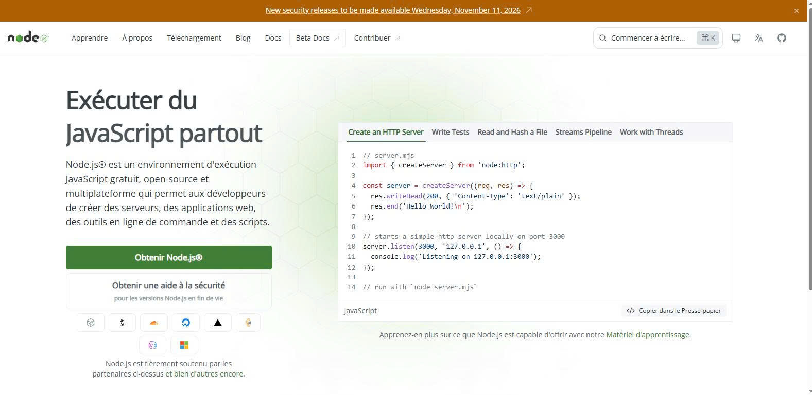
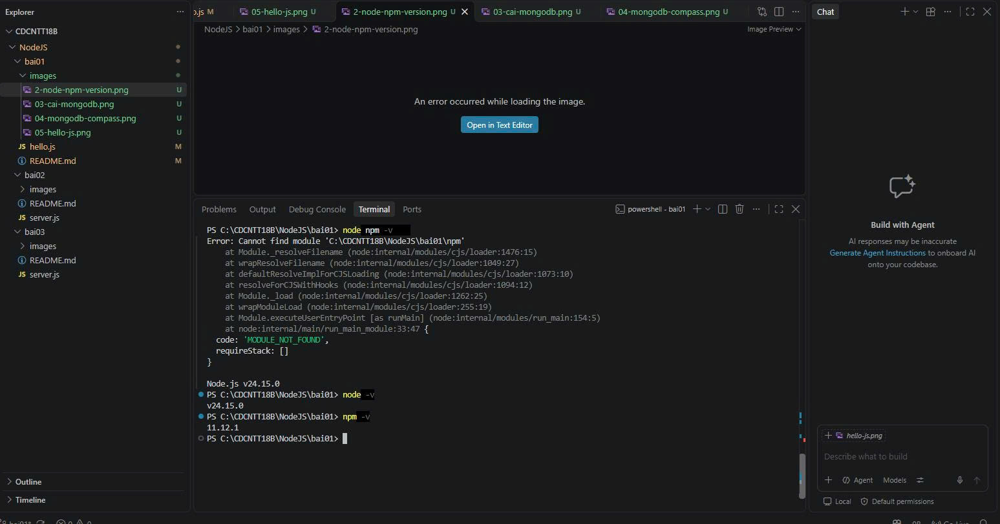
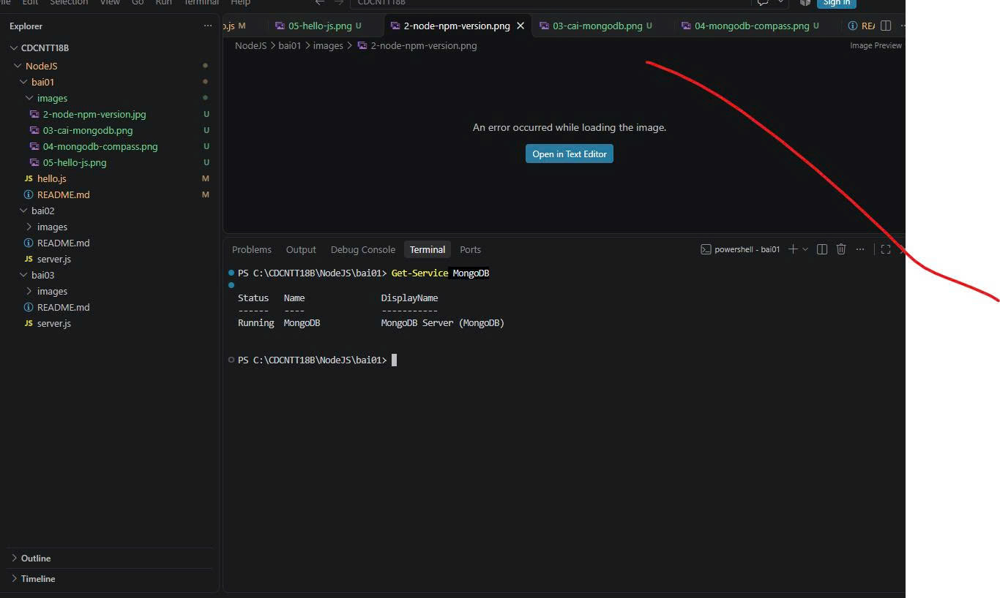
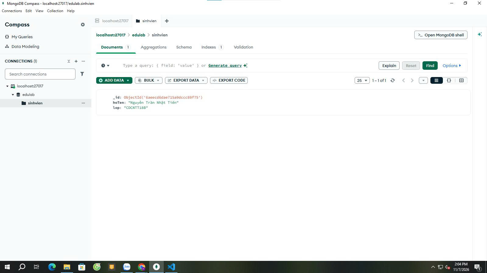
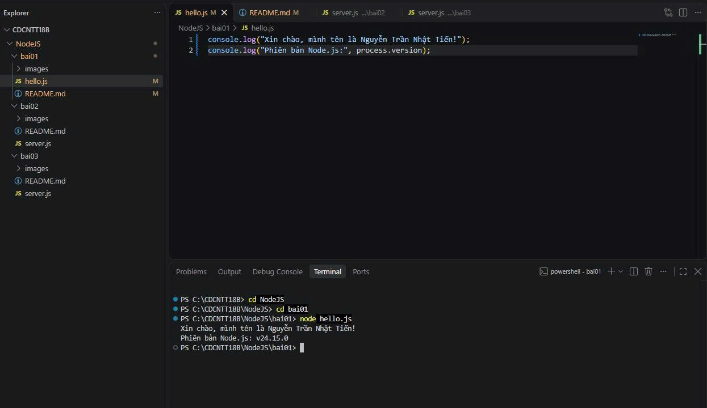

# Bài 1 — Tổng quan Node.js và MongoDB

Sinh viên: Nguyễn Trần Nhật Tiến | Mã SV:CDCNTT18B23 | Lớp: CDCNTT18B

## 1. Tổng quan
- **Node.js**: môi trường chạy JavaScript phía server, dựa trên engine V8 của Chrome.
- **MongoDB**: cơ sở dữ liệu NoSQL, lưu dữ liệu dạng document (JSON/BSON).
- Node.js kết hợp MongoDB thường dùng để xây dựng ứng dụng web và API.

## 2. Cài đặt Node.js LTS
Tải bản LTS từ https://nodejs.org và cài đặt với tùy chọn mặc định.



## 3. Kiểm tra phiên bản
```
node -v
npm -v
```
Kết quả: Node.js v24.15.0, npm 11.12.1.



## 4. Cài đặt MongoDB
Cài MongoDB Community Server và MongoDB Compass. Kiểm tra service bằng `Get-Service MongoDB`, trạng thái Running.



Kết nối Compass tới `mongodb://localhost:27017`, tạo database `edulab`, collection `sinhvien` và thêm 1 document:



## 5. Tạo và chạy hello.js
```javascript
console.log("Xin chào, mình tên là Nguyễn Trần Nhật Tiến!");
console.log("Phiên bản Node.js:", process.version);
```
Chạy: `node hello.js`



Kết quả: in ra lời chào và phiên bản Node.js.