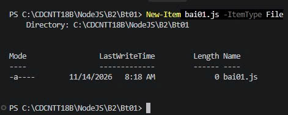
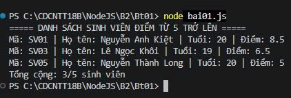

# Bt01 — Quản lý thông tin sinh viên bằng JavaScript ES6

Sinh viên: Nguyễn Trần Nhật Tiến | Mã SV: CDCNTT18B23 | Lớp: CDCNTT18B

## 1. Mô tả
Chương trình khai báo danh sách 5 sinh viên (mã, họ tên, tuổi, điểm) bằng
class và constructor. Dùng arrow function để lọc sinh viên có điểm từ 5
trở lên, sau đó hiển thị bằng console.log().

## 2. Các lệnh thực hiện

Bước 1: Tạo file bai01.js

    cd B2/Bt01
    New-Item bai01.js -ItemType File

Bước 2: Viết code (class SinhVien, mảng 5 sinh viên, arrow function lọc)

Bước 3: Chạy chương trình

    node bai01.js

## 3. Ảnh các bước

**Tạo file bai01.js**

**Code**

## 4. Kết quả cuối cùng

