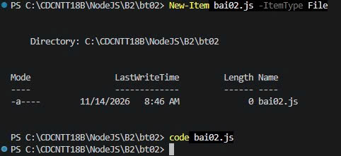

# Bt02 — Tạo Web Server với Node.js

Sinh viên: Nguyễn Trần Nhật Tiến | Mã SV: CDCNTT18B23 | Lớp: CDCNTT18B

## 1. Mô tả
Dùng module http tạo Web Server tại cổng 3000. Đường dẫn / hiển thị lời chào
và mã sinh viên, /about hiển thị giới thiệu bản thân, đường dẫn không tồn tại
trả về mã trạng thái HTTP 404.

## 2. Các lệnh thực hiện

Bước 1: Tạo file bai02.js

    cd B2/Bt02
    New-Item bai02.js -ItemType File

Bước 2: Viết code (http.createServer, kiểm tra req.url, listen cổng 3000)

Bước 3: Chạy server

    node bai02.js

Mở trình duyệt tại http://localhost:3000 và http://localhost:3000/about

## 3. Ảnh các bước

**Bước 1: Tạo file bai02.js**

**Bước 2: Code**

**Bước 3: Chạy server và kết quả**

