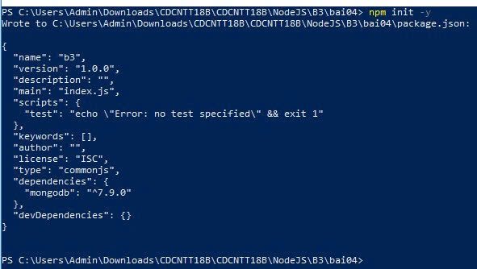
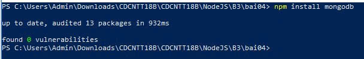
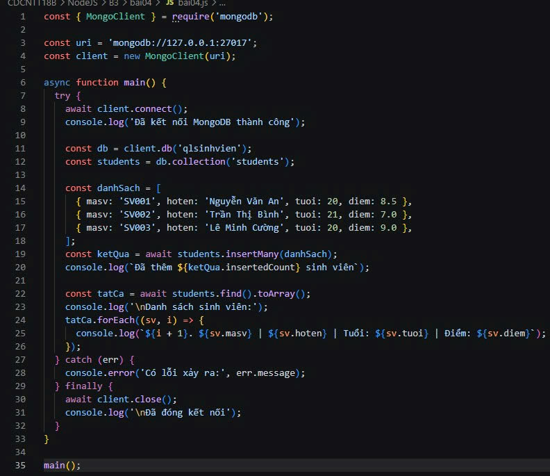
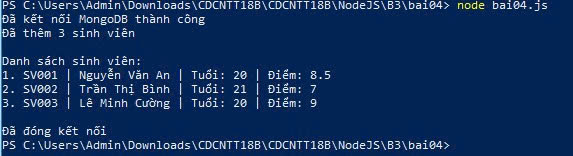

# Bt04 — Thêm và hiển thị dữ liệu MongoDB

Sinh viên: Nguyễn Trần Nhật Tiến | Mã SV: CDCNTT18B23 | Lớp: CDCNTT18B

## 1. Mô tả
Dùng thư viện mongodb kết nối MongoDB trên máy, sử dụng database `qlsinhvien`, collection `students`. Thêm 3 sinh viên bằng `insertMany()`, hiển thị danh sách bằng `find()` và đóng kết nối sau khi hoàn thành.

## 2. Các lệnh thực hiện

Bước 1: Khởi tạo project

    npm init -y

Bước 2: Cài thư viện mongodb

    npm install mongodb

Bước 3: Tạo file bai04.js và viết code (connect, insertMany, find, close)

    New-Item bai04.js -ItemType File

Bước 4: Chạy chương trình

    node bai04.js

## 3. Ảnh các bước

**Bước 1: npm init -y**

**Bước 2: npm install mongodb**

**Bước 3: Code bai04.js**

## 4. Kết quả cuối cùng

**Terminal hiển thị danh sách sinh viên đã thêm vào MongoDB**

