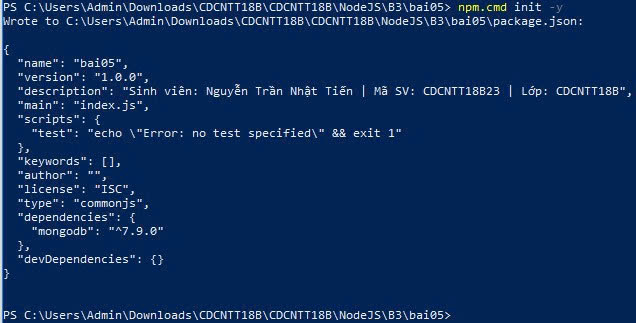
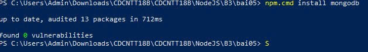
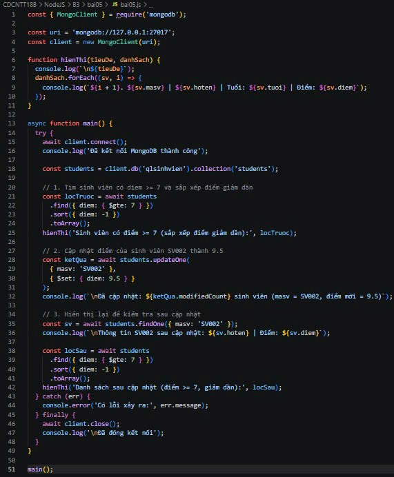
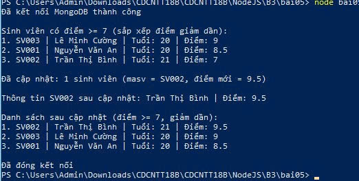

# Bt05 — Tìm kiếm, cập nhật và sắp xếp MongoDB

Sinh viên: Nguyễn Trần Nhật Tiến | Mã SV: CDCNTT18B23 | Lớp: CDCNTT18B

## 1. Mô tả
Dùng collection `students` của Bài 4: tìm sinh viên có điểm >= 7 bằng `find()` và `$gte`, sắp xếp điểm giảm dần bằng `sort()`, cập nhật điểm theo `masv` bằng `updateOne()` và `$set`, rồi hiển thị lại để kiểm tra.

## 2. Các lệnh thực hiện

Bước 1: Khởi tạo project

    npm init -y

Bước 2: Cài thư viện mongodb

    npm install mongodb

Bước 3: Tạo file bai05.js và viết code (find, sort, updateOne)

    New-Item bai05.js -ItemType File

Bước 4: Chạy chương trình

    node bai05.js

## 3. Ảnh các bước

**Bước 1: npm init -y**

**Bước 2: npm install mongodb**

**Bước 3: Code bai05.js**

## 4. Kết quả cuối cùng

**Danh sách lọc, sắp xếp đúng và điểm SV002 được cập nhật thành công**

