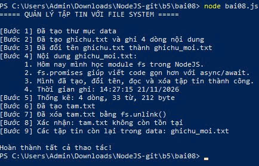

# Bài 8: Quản lý tập tin với File System

## 1. Mô tả bài

Chương trình dùng module `fs` (phiên bản `fs.promises` với `async/await`) để thực hiện lần lượt các thao tác:

| STT | Thao tác | Hàm sử dụng |
|---|---|---|
| 1 | Tạo thư mục `data` | `fs.mkdir()` |
| 2 | Tạo `ghichu.txt`, ghi 4 dòng nội dung | `fs.writeFile()` |
| 3 | Đổi tên thành `ghichu_moi.txt` | `fs.rename()` |
| 4 | Đọc và hiển thị nội dung | `fs.readFile()` |
| 5 | Tạo `tam.txt` rồi xóa | `fs.writeFile()`, `fs.unlink()` |

Mỗi thao tác đều in thông báo kết quả ra Terminal.

### Chức năng riêng thêm vào

- Đánh số từng bước trong thông báo.
- Thống kê số dòng, số từ, dung lượng (byte) của tập tin.
- Kiểm tra `tam.txt` đã bị xóa thật bằng `fs.access()`.
- Liệt kê các tập tin còn lại trong `data` bằng `fs.readdir()`.
- Bắt lỗi bằng `try...catch`, chạy lại nhiều lần không bị lỗi.

## 2. Các bước thực hiện

### Bước 1: Tạo file `bai08.js`

Dùng `require('fs').promises` và viết các thao tác theo đúng thứ tự đề bài.


### Bước 2: Chạy chương trình

Mở PowerShell, vào thư mục bài 8 rồi chạy lệnh:

```
cd C:\Users\Admin\Downloads\CDCNTT18B\CDCNTT18B\NodeJS\B5\bai08
node bai08.js
```

### Bước 3: Kiểm tra thư mục data

Sau khi chạy, thư mục `data` chứa `ghichu_moi.txt`; `ghichu.txt` đã được đổi tên và `tam.txt` đã bị xóa.


## 3. Kết quả

Chương trình hiển thị thông báo thành công cho từng thao tác: tạo thư mục, ghi tập tin, đổi tên, đọc nội dung, tạo và xóa `tam.txt`.

