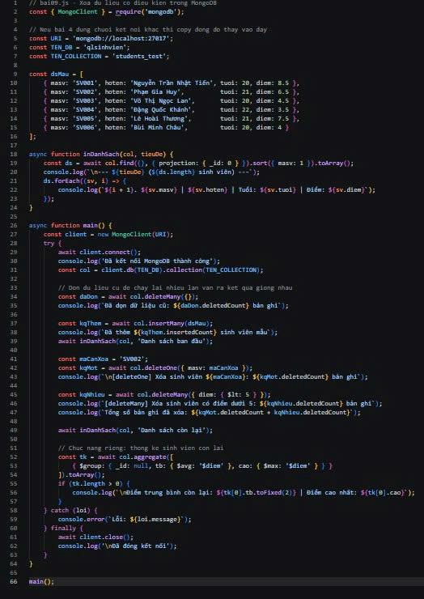
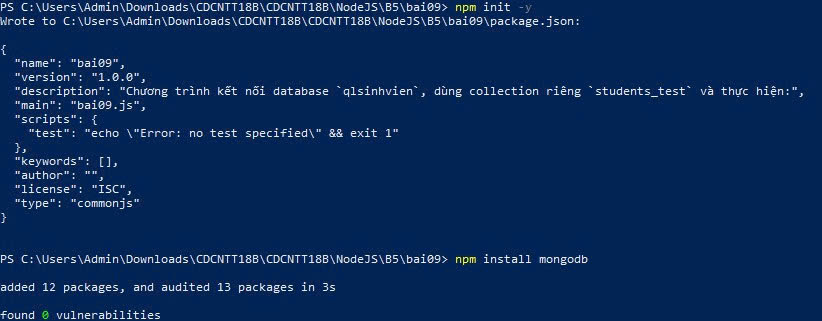
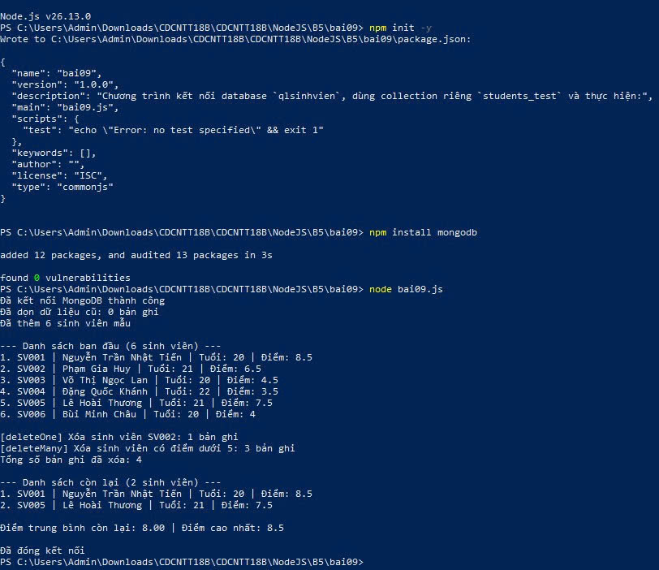

# Bài 9: Xóa dữ liệu có điều kiện trong MongoDB

## 1. Mô tả bài

Chương trình kết nối database `qlsinhvien`, dùng collection riêng `students_test` và thực hiện:

| STT | Thao tác | Hàm sử dụng |
|---|---|---|
| 1 | Thêm 6 sinh viên mẫu (masv, hoten, tuoi, diem) | `insertMany()` |
| 2 | Xóa 1 sinh viên theo mã `SV002` | `deleteOne()` |
| 3 | Xóa các sinh viên có điểm dưới 5 | `deleteMany({ diem: { $lt: 5 } })` |
| 4 | Hiển thị số bản ghi đã xóa và danh sách còn lại | `find()` |

### Chức năng riêng thêm vào

- Dọn dữ liệu cũ trước khi thêm, chạy lại nhiều lần vẫn cho kết quả giống nhau.
- Hiển thị danh sách trước và sau khi xóa để dễ so sánh.
- Tính tổng số bản ghi đã xóa từ cả hai lệnh xóa.
- Thống kê điểm trung bình và điểm cao nhất của sinh viên còn lại bằng `aggregate()`.
- Bắt lỗi bằng `try...catch...finally`, luôn đóng kết nối.

## 2. Các bước thực hiện

### Bước 1: Tạo file `bai09.js`

Dùng `require('mongodb')`, kết nối database `qlsinhvien` và viết các thao tác theo đề bài.



### Bước 2: Cài thư viện mongodb

```
cd C:\Users\Admin\Downloads\CDCNTT18B\CDCNTT18B\NodeJS\B5\bai09
npm init -y
npm install mongodb
```



### Bước 3: Chạy chương trình

```
node bai09.js
```

## 3. Kết quả

Chương trình thêm 6 sinh viên, xóa 1 sinh viên bằng `deleteOne()`, xóa 3 sinh viên điểm dưới 5 bằng `deleteMany()` (tổng 4 bản ghi đã xóa) và hiển thị 2 sinh viên còn lại.

