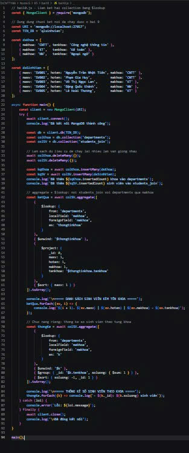
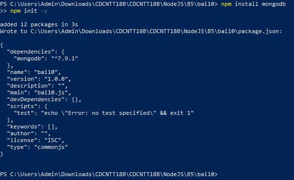

# Bài 10: Liên kết hai Collection trong MongoDB

## 1. Mô tả bài

Chương trình kết nối database `qlsinhvien`, tạo 2 collection và liên kết bằng `$lookup`:

| Collection | Nội dung | Trường |
|---|---|---|
| `departments` | 3 khoa | `makhoa`, `tenkhoa` |
| `students_join` | 5 sinh viên | `masv`, `hoten`, `makhoa` |

Dùng `aggregate()` với `$lookup` để nối `students_join` với `departments` qua trường `makhoa`, hiển thị danh sách sinh viên kèm **tên khoa** (không chỉ mã khoa).

### Các stage sử dụng

| Stage | Công dụng |
|---|---|
| `$lookup` | Nối sinh viên với khoa theo `makhoa` |
| `$unwind` | Tách mảng kết quả của `$lookup` thành từng đối tượng |
| `$project` | Chọn trường hiển thị, lấy `tenkhoa` |
| `$sort` | Sắp xếp theo mã sinh viên |

### Chức năng riêng thêm vào

- Dọn dữ liệu cũ trước khi thêm, chạy lại nhiều lần vẫn cho kết quả giống nhau.
- Thống kê số sinh viên theo từng khoa bằng `$lookup` kết hợp `$group`.
- Bắt lỗi bằng `try...catch...finally`, luôn đóng kết nối.

## 2. Các bước thực hiện

### Bước 1: Tạo file `bai10.js`

Dùng `require('mongodb')`, tạo dữ liệu mẫu cho 2 collection và viết truy vấn `aggregate()`.



### Bước 2: Cài thư viện mongodb

```
cd C:\Users\Admin\Downloads\CDCNTT18B\CDCNTT18B\NodeJS\B5\bai10
npm init -y
npm install mongodb
```



### Bước 3: Chạy chương trình

```
node bai10.js
```

## 3. Kết quả

Chương trình thêm 3 khoa và 5 sinh viên, hiển thị danh sách sinh viên kèm tên khoa tương ứng và thống kê số sinh viên theo khoa.

