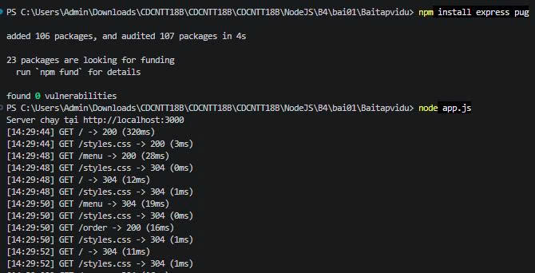
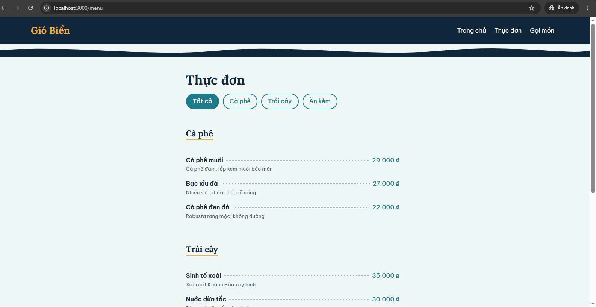
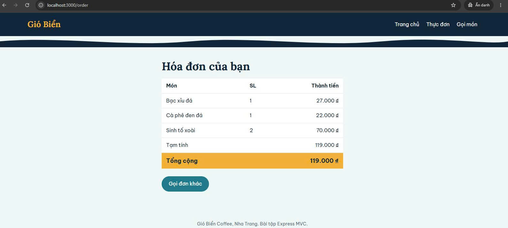

# Gió Biển Coffee – Bài thực hành Express (Express Framework)

Bài thực hành môn NodeJS – Bài 4: Xây dựng web với nền tảng Express.

Ứng dụng web cho một quán cà phê nhỏ ở Nha Trang. Người dùng có thể xem thực đơn, lọc theo nhóm món, nhập số lượng để gọi món và nhận hóa đơn. Đơn từ 150.000 ₫ được giảm 10%.

## 1. Công nghệ sử dụng

| Thành phần | Công cụ |
|---|---|
| Nền tảng chạy | Node.js |
| Web framework | Express |
| Template engine | Pug |
| Mô hình | MVC (Model – View – Controller) |
| Giao diện | CSS thuần (`public/styles.css`) |

## 2. Cấu trúc thư mục

```
Baitapvidu/
├── app.js                          # Khởi tạo Express, cấu hình middleware, xử lý lỗi
├── package.json                    # Khai báo thư viện
├── controllers/
│   └── shopController.js           # Controller: định nghĩa các route
├── models/
│   └── menuModel.js                # Model: dữ liệu thực đơn, tính hóa đơn
├── middlewares/
│   └── logger.js                   # Middleware tự viết: ghi log yêu cầu
├── views/
│   ├── layout.pug                  # Khung chung (menu, footer)
│   ├── index.pug                   # Trang chủ
│   ├── menu.pug                    # Thực đơn
│   ├── order.pug                   # Form gọi món
│   ├── bill.pug                    # Hóa đơn
│   └── error.pug                   # Trang lỗi
├── public/
│   └── styles.css                  # CSS tĩnh
└── images/                         # Ảnh chụp kết quả dùng trong README
```

## 3. Các lệnh thực hiện

**Bước 1.** Mở Terminal trong VS Code, di chuyển vào thư mục bài tập:

```bash
cd NodeJS/B4/bai01/Baitapvidu
```

**Bước 2.** Khởi tạo dự án (tạo file `package.json`):

```bash
npm init -y
```

**Bước 3.** Cài Express và Pug:

```bash
npm install express pug
```

**Bước 4.** Chạy ứng dụng:

```bash
node app.js
```

Terminal hiển thị `Server chạy tại http://localhost:3000` là chạy thành công.

**Bước 5.** Mở trình duyệt và truy cập http://localhost:3000.

### Ảnh chạy lệnh

Cài thư viện và khởi động server:



## 4. Các route của ứng dụng

| Phương thức | Đường dẫn | Chức năng |
|---|---|---|
| GET | `/` | Trang chủ, hiển thị 3 món nổi bật |
| GET | `/menu` | Thực đơn đầy đủ |
| GET | `/menu?loai=caphe` | Lọc theo nhóm món (`caphe`, `trai-cay`, `banh`) |
| GET | `/order` | Form nhập số lượng từng món |
| POST | `/order` | Nhận dữ liệu form, tính và hiển thị hóa đơn |
| ANY | đường dẫn khác | Trả về lỗi 404 |

## 5. Kết quả chạy

### Trang chủ `/`

Giới thiệu quán và 3 món được gọi nhiều.


### Thực đơn `/menu`

Danh sách món chia theo 3 nhóm: Cà phê, Trái cây, Ăn kèm. Có nút lọc theo nhóm.



### Hóa đơn (kết quả cuối)

Sau khi nhập số lượng ở `/order` và bấm "Tính hóa đơn", ứng dụng hiển thị chi tiết từng món, tạm tính, mức giảm 10% (nếu đơn từ 150.000 ₫) và tổng cộng.



## 6. Giải thích mô hình MVC trong bài

- **Model** (`models/menuModel.js`): chứa danh sách món và hàm `tinhHoaDon()`. Hàm này kiểm tra số lượng (số nguyên từ 0 đến 50), tính tạm tính, giảm giá 10% cho đơn từ 150.000 ₫ và trả về hóa đơn. Model không biết gì về giao diện.
- **View** (`views/*.pug`): chỉ hiển thị dữ liệu nhận từ Controller. `layout.pug` là khung chung, các trang khác dùng `extends layout`.
- **Controller** (`controllers/shopController.js`): nhận yêu cầu từ trình duyệt, gọi Model lấy hoặc tính dữ liệu, rồi chọn View để trả về.

Luồng xử lý khi gọi món:

```
Trình duyệt (POST /order)
   -> Controller đọc req.body.qty
   -> Model tinhHoaDon() tính toán
   -> Controller render view bill.pug
   -> Trình duyệt hiển thị hóa đơn
```

## 7. Các khái niệm Express đã sử dụng

- **Route**: `app.use('/', shopController)` gắn router, bên trong dùng `router.get()` và `router.post()`.
- **Middleware**:
  - `logger` (tự viết): ghi giờ, phương thức, đường dẫn và mã trạng thái mỗi yêu cầu ra Terminal.
  - `express.urlencoded`: đọc dữ liệu form gửi bằng POST.
  - `express.static`: phục vụ file CSS trong thư mục `public`.
- **Template engine**: Pug, dùng `extends`, `block`, `each`, `if` và hàm `vnd()` định dạng tiền.
- **Error handling**:
  - Controller gọi `next(err)` khi dữ liệu sai (ví dụ chưa chọn món, mã 400).
  - Route không khớp tạo lỗi 404.
  - Middleware lỗi (4 tham số) đặt cuối `app.js` render trang `error.pug`.

## 8. Đẩy bài lên GitHub

```bash
git add .
git commit -m "Bai04 - Baitapvidu: Express MVC Gio Bien Coffee"
git push
```