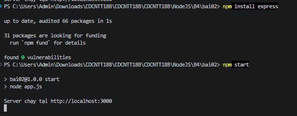
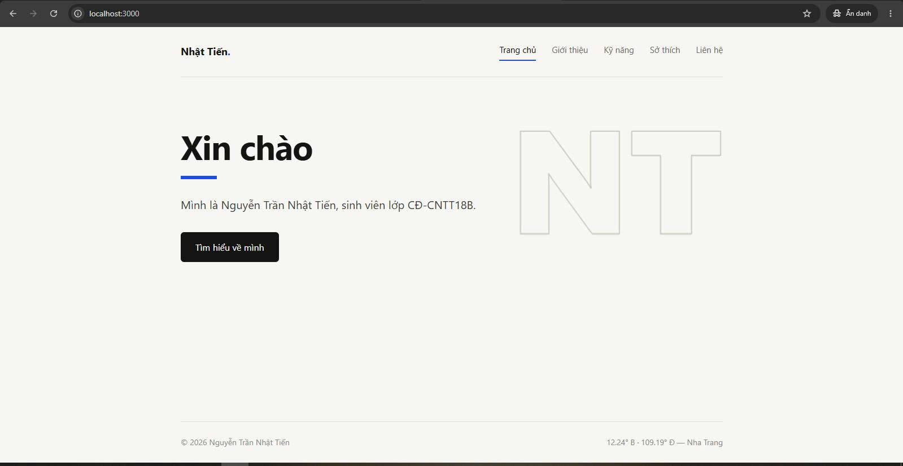
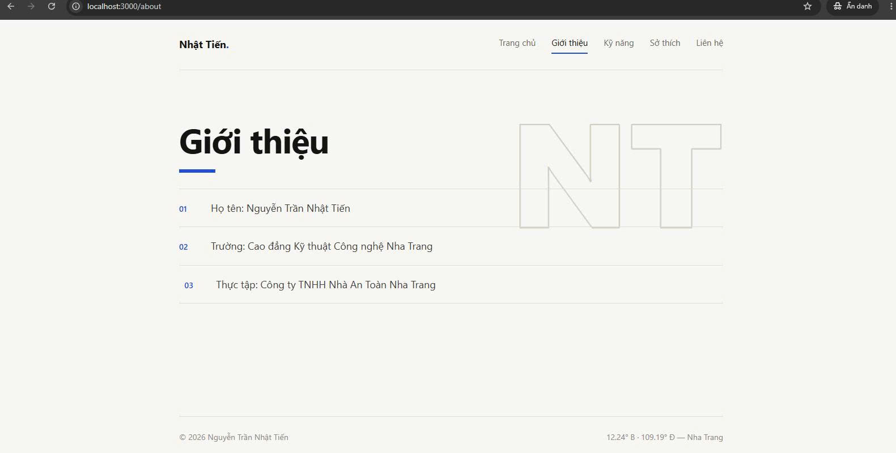
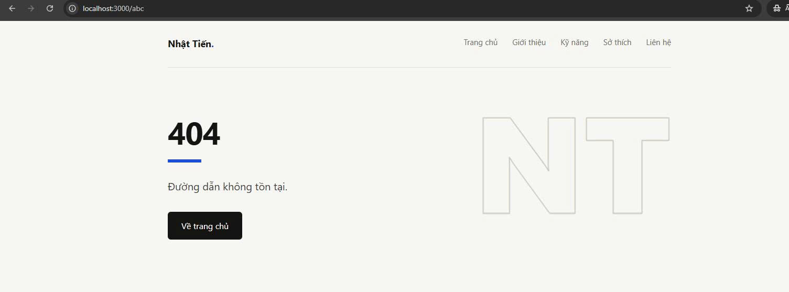

# Bài 4 - Bài 01: Website giới thiệu cá nhân với Express
**Sinh viên:** Nguyễn Trần Nhật Tiến - CĐ-CNTT18B

## Phần 1. Chạy trên localhost

```
npm init -y
npm install express
npm pkg set scripts.start="node app.js"
npm start
```


Các route: `/`, `/about`, `/skills`, `/hobbies`, `/contact`. Đường dẫn khác trả về lỗi 404.

**Trang chủ** (`localhost:3000`)



**Giới thiệu** (`localhost:3000/about`)



**Lỗi 404** (`localhost:3000/abc`)



## Phần 2. Triển khai trên hosting miễn phí

| Dịch vụ | Gói miễn phí (tra ngày 28/11/2026) | Hạn chế |
|---|---|---|
| Render | 750 giờ/tháng | Ngủ sau 15 phút không truy cập |
| Vercel Hobby | 1 triệu lượt gọi hàm/tháng | Chạy dạng serverless, bỏ qua express.static() |
| Railway Free | Dùng thử 5 USD/30 ngày, sau đó 1 USD/tháng | Hết hạn mức thì dừng |

**Chọn Render** vì chạy được server Express như trên máy và deploy từ GitHub.

Các bước:
1. Đẩy mã lên GitHub.
2. Đăng nhập render.com, chọn New > Web Service, chọn repo.
3. Root Directory: `NodeJS/B4/bai02`
4. Build Command: `npm install`, Start Command: `npm start`, gói Free.
5. Bấm Deploy, chờ trạng thái Live.

**Link ứng dụng:** (dán link Render vào đây)