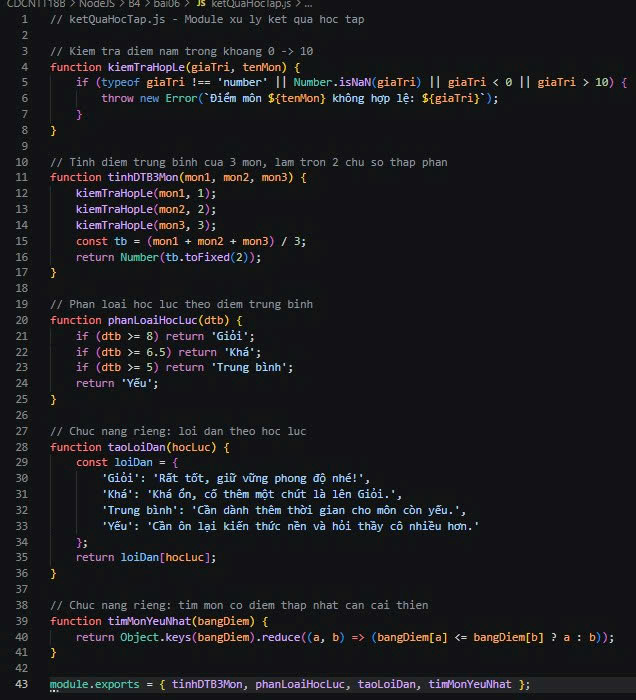
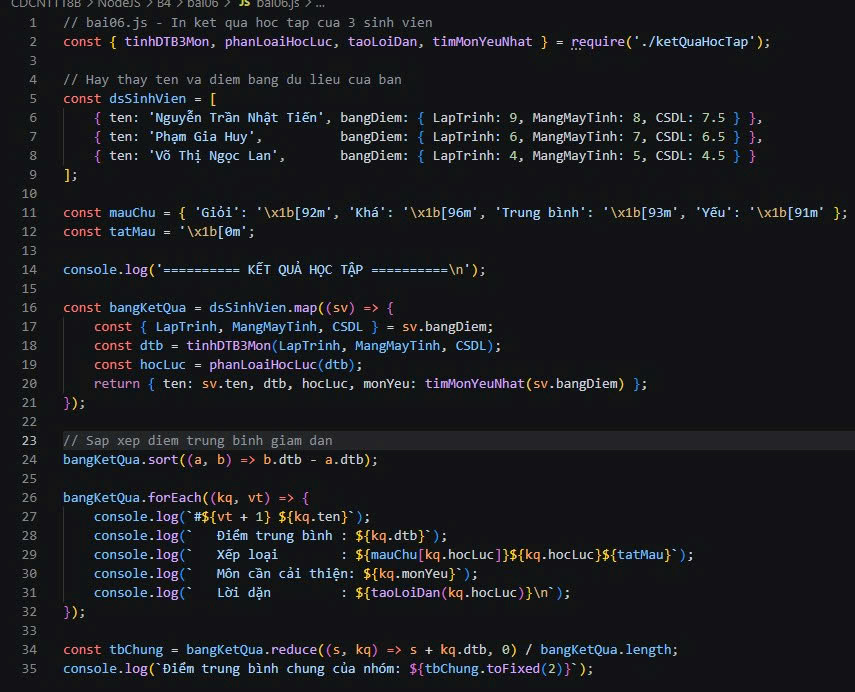
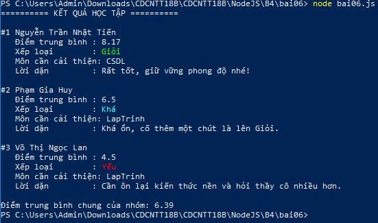

# Bài 6: Xây dựng Module tính kết quả học tập

## 1. Mô tả bài

Chương trình tính điểm trung bình 3 môn và xếp loại học lực cho 3 sinh viên, gồm 2 file:

- `ketQuaHocTap.js`: module chứa các hàm xử lý, xuất bằng `module.exports`.
- `bai06.js`: tạo dữ liệu 3 sinh viên, dùng `require()` để gọi các hàm và in kết quả ra Terminal.

### Quy tắc xếp loại

| Điểm trung bình | Xếp loại |
|---|---|
| Từ 8 trở lên | Giỏi |
| Từ 6,5 đến dưới 8 | Khá |
| Từ 5 đến dưới 6,5 | Trung bình |
| Dưới 5 | Yếu |

### Các hàm trong module

| Hàm | Chức năng |
|---|---|
| `tinhDTB3Mon(m1, m2, m3)` | Tính điểm trung bình 3 môn, làm tròn 2 chữ số |
| `phanLoaiHocLuc(dtb)` | Xếp loại học lực theo điểm trung bình |
| `taoLoiDan(hocLuc)` | Chức năng riêng: lời dặn theo học lực |
| `timMonYeuNhat(bangDiem)` | Chức năng riêng: tìm môn điểm thấp nhất cần cải thiện |

### Chức năng riêng thêm vào

- Kiểm tra điểm hợp lệ (từ 0 đến 10), sai thì báo lỗi.
- Sắp xếp sinh viên theo điểm trung bình giảm dần.
- Tìm môn cần cải thiện và đưa ra lời dặn cho từng sinh viên.
- Tô màu xếp loại trên Terminal.
- Tính điểm trung bình chung của nhóm.

## 2. Các bước thực hiện

### Bước 1: Tạo module `ketQuaHocTap.js`

Viết các hàm tính điểm, xếp loại rồi xuất bằng `module.exports`.



### Bước 2: Tạo file `bai06.js`

Dùng `require('./ketQuaHocTap')` để gọi các hàm, tạo dữ liệu 3 sinh viên và in kết quả.



### Bước 3: Chạy chương trình

Mở PowerShell, vào thư mục bài 6 rồi chạy lệnh:

```
cd C:\Users\Admin\Downloads\CDCNTT18B\CDCNTT18B\NodeJS\B3\bai06
node bai06.js
```

## 3. Kết quả

| Sinh viên | Điểm TB | Xếp loại |
|---|---|---|
| Nguyễn Trần Nhật Tiến | 8.17 | Giỏi |
| Phạm Gia Huy | 6.5 | Khá |
| Võ Thị Ngọc Lan | 4.5 | Yếu |

Điểm trung bình chung của nhóm: **6.39**

